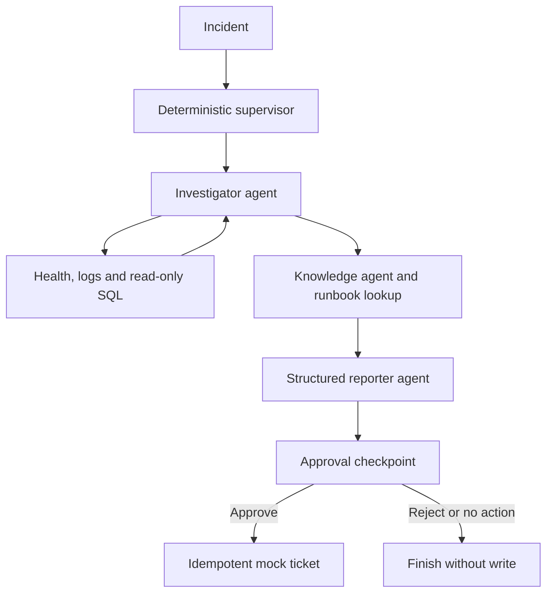

# OpsPilot

A LangGraph incident-triage application that investigates synthetic backend incidents using
health checks, logs, read-only SQL and operational runbooks. It produces an evidence-linked
report and pauses for human approval before creating an idempotent **mock ticket**.

Built with Python 3.12, FastAPI, Gemini, LangGraph, Pydantic and SQLite, with optional
PostgreSQL graph checkpoints, Langfuse tracing and DocuRAG runbook retrieval.

## Quick start

Requires Python 3.12 and [uv](https://docs.astral.sh/uv/).

```bash
git clone https://github.com/shaheen-728/OpsPilot.git
cd OpsPilot
bash run_local.sh
```

The startup script creates `.env` from `.env.example` only if it does not already exist,
installs the locked dependencies and starts the API on port 8001.

- Browser demo: http://127.0.0.1:8001
- Swagger API docs: http://127.0.0.1:8001/docs
- Health check: http://127.0.0.1:8001/health

Select `inc-001`, click **Investigate**, review the evidence, and click **Approve mock ticket**.
The first run uses the deterministic offline provider: no API credentials or model calls.
Keep the terminal running; stop with Ctrl+C. State remains in `var/`.

From an already extracted project, simply run `bash run_local.sh` in its root directory.
Port 8001 allows OpsPilot and local DocuRAG on port 8000 to run side by side.

## Architecture



In Gemini **supervisor** mode, three specialist LLM agents perform investigation, interpretation
of retrieved runbooks and report generation. Routing is deterministic, and write authorization
is controlled by application code. In **single** mode, one investigator has all four read-tools;
report rendering is deterministic. Offline mode uses a transparent fixture-state mapping,
not an LLM. The graph has a fixed sequence; its step count is not an adaptive reasoning metric.

## Implemented features

- Native Gemini function calling with typed arguments and an explicit tool-execution loop.
- Bounded model turns/tool calls, per-call timeouts, token-usage checks and server-error retries.
- Scoped synthetic service health and log tools, with level and time filters.
- SELECT-only SQLite investigation queries with AST restrictions, a read-only connection,
  database authorization checks, a row limit and an execution deadline.
- Local lexical runbook lookup, or an optional HTTP tool calling DocuRAG's `/search` endpoint.
- Pydantic reports with evidence IDs checked against successful recorded observations.
- Human approval with LangGraph `interrupt()` and checkpoint-based resume.
- Mock tickets with a unique incident key to prevent duplicate creation during replay.
- FastAPI background execution, live/replay SSE events and a small browser UI.
- Durable local checkpoints, JSONL audit events and optional PostgreSQL/Langfuse integrations.
- Resumable evaluation with dataset/code identity checks and explicit failure accounting.

Evidence-ID validation confirms that an observation exists; it does not independently prove
that the model's claim follows from that observation. Proposed corrective operations remain
recommendations, not executed actions. Ticket approval does not authorize service remediation.

## Evaluation results

The dataset contains **30 synthetic development scenarios**, generated from six root-cause
patterns across five services. It is not a held-out test or a production incident benchmark.

### Supervisor configuration

Model: `gemini-3.5-flash-lite`. Completed evaluation after checkpoint-based recovery:

| Metric | Result |
| --- | ---: |
| Evaluated scenarios | 30/30 |
| Accepted root-cause accuracy | 1.000 |
| Task success rate | 1.000 |
| Exact tool-set match | 1.000 |
| Mean tool precision / recall | 1.000 / 1.000 |
| Mean completed workflow steps | 6 |
| p95 completed active execution latency | 47.77 s |
| Estimated API cost | Not measured |

[Saved supervisor report](results/gemini-supervisor-v2.md)

These are recovered-run results, **not first-attempt reliability**. Active latency sums saved
successful execution segments and excludes human approval wait, client network time and
failed attempts. Quota/provider errors required recovery; failed calls without usage metadata
are not included in cost estimates. No model-price assumptions are used to fill missing costs.

### Single-agent comparison

The single-agent evaluation is in progress. One attempt omitted the required SQL tool and
was recorded as an agent failure without retrying it until correct. Final comparative scores
will be published when all cases are resolved. No superiority claim is made from the current data.

A required-tool match measures compliance with this fixture workflow, not whether every tool
would be necessary for every real incident. The evaluator requires the same defined tools for
these cases, including SQL. Partial reports are provisional and show their scoring denominator.

## Enable Gemini

Edit the existing private `.env`:

```dotenv
PROVIDER=gemini
GEMINI_API_KEY=your-key
GEMINI_MODEL=gemini-3.5-flash-lite
```

Restart the server after editing configuration. Test one incident first:

```bash
uv run opspilot demo --scenario inc-001
```

The command stops at approval when a mock ticket is proposed. Inspect the report and approve
through the API/UI. The `--approve` CLI flag explicitly authorizes the new demo's mock ticket.
Keep credentials private. Live Gemini investigation and supervisor evaluation have been run
locally; mocked SDK tests also exercise function-call continuation and structured specialist output.
Provider availability and free-tier quotas can still interrupt runs.

## API example

Start an incident with a request-scoped idempotency key:

```bash
curl -sS http://127.0.0.1:8001/incidents \
  -H 'Content-Type: application/json' \
  -H 'Idempotency-Key: demo-lock-1' \
  -d '{"scenario_id":"inc-001","architecture":"supervisor"}'
```

Use the returned incident ID:

```bash
curl -N http://127.0.0.1:8001/incidents/INCIDENT_ID/events
curl -sS http://127.0.0.1:8001/incidents/INCIDENT_ID
curl -sS http://127.0.0.1:8001/incidents/INCIDENT_ID/approve \
  -H 'Content-Type: application/json' \
  -d '{"decision":"approve","note":"Reviewed the evidence"}'
```

Use `"decision":"reject"` to finish without a ticket. Repeated identical approvals return the
saved result; conflicting decisions return HTTP 409. `GET /scenarios` lists fixture IDs.
Healthy cases propose no write and complete without requiring approval. SSE events can be
replayed from `?after=EVENT_SEQUENCE`.

The API's `/incidents/INCIDENT_ID/retry` resumes an interrupted investigation from its checkpoint.
Do not automatically retry known agent-validation failures to improve benchmark scores.
Diagnose saved provider errors before retrying quota, authentication or invalid-request failures.

## Resumable evaluation

Choose Gemini in `.env` before starting a live evaluation. The current evaluator keeps
completed cases, preserves incident IDs, defers provider errors and records confirmed missing-tool
failures. A complete report includes failed cases rather than silently dropping them.

For a **new** evaluation, use fresh output names:

```bash
uv run python scripts/eval_resumable_v2.py \
  --architecture supervisor --limit 30 --max-cases 5 --pause 65 \
  --output results/supervisor-new.json

uv run python scripts/eval_resumable_v2.py \
  --architecture single --limit 30 --max-cases 5 --pause 65 \
  --output results/single-new.json
```

Repeat the same command to resume its unfinished cases. Each scenario can make multiple model
requests. Inter-case pacing reduces quota pressure but does not enforce a per-model-call rate
limit. A 429 must be distinguished from permanent authentication or request errors.

Progress is saved in `.progress.json`. `.partial.json` and `.partial.md` are provisional;
the final `.json` and `.md` appear when every selected case is resolved. Keep the model,
prompts, dataset, state directory and pricing settings unchanged within a run. The in-progress
single-agent report uses `results/gemini-single-v2.*`; use its existing identity to resume it.

For offline wiring checks, set `PROVIDER=offline` and use a separate output. Included reports
under `verification/` are deterministic smoke tests, not LLM quality scores.

Evaluation labels are not passed to the agent. Accuracy uses expected diagnosis labels;
task success also requires the expected action and tools. Tool precision/recall use successful
observed tool names. Genuine missing-tool failures count against overall success; completed-only
diagnosis accuracy and latency denominators are reported separately. Unknown errors remain
unresolved for inspection. See the recovery notes and `DECISIONS.md` for implementation details.

## Persistence and optional integrations

### Checkpoints

SQLite graph checkpoints and the application database live under `var/`. Tests verify restart
at approval, resume after failure and duplicate-ticket prevention after a simulated crash.
The API uses an in-process executor, not a durable job broker; interrupted running incidents
need explicit recovery. Use **one API process**; multi-worker execution is not supported.

PostgreSQL graph checkpoint support is available with:

```bash
uv sync --locked --extra postgres
```

Configure `CHECKPOINT_URL` privately. Use certificate and hostname verification for a remote
TLS-enabled database. The checkpoint role needs permission to create LangGraph's tables.
The incident/event/ticket application database remains SQLite, and the investigation SQL tool
is a SQLite fixture. PostgreSQL read-only investigation roles are not implemented.
The local real-PostgreSQL integration test remains unverified/skipped until a test URL is supplied.

### Docker Compose

With your private `.env` already configured:

```bash
docker compose up --build -d --wait
```

Compose configures PostgreSQL for graph checkpoints and persistent volumes for both checkpoint
and application state. Docker packaging is included; a successful local Docker verification is
not claimed here. Local demo database credentials are not production credentials.
`docker compose down` stops services; `down -v` intentionally deletes their stored state.

### DocuRAG

Set `DOCURAG_URL` to a reachable DocuRAG service containing appropriate operational runbooks.
The tool sends a keyword `/search` request with reranking disabled and a bounded timeout.
Leave it empty to use bundled lexical runbooks. The external integration is optional;
local lexical retrieval is not embedding-based RAG.

### Langfuse and cost

```bash
uv sync --locked --extra tracing
```

Configure `LANGFUSE_ENABLED`, `LANGFUSE_PUBLIC_KEY`, `LANGFUSE_SECRET_KEY` and
`LANGFUSE_BASE_URL` privately. Local audit events are available in `var/traces.jsonl` regardless
of external tracing. Langfuse export is optional; account-level verification is not yet claimed.

Cost estimation requires verified model prices in `INPUT_USD_PER_MILLION` and
`OUTPUT_USD_PER_MILLION`. Missing prices or missing successful-response usage remain `null`.
Estimates exclude infrastructure, external tools and failed work without saved usage metadata.
Offline mode has zero model API calls, not necessarily zero operating cost.

## Tests and CI

Latest local verification: **37 passed, 1 skipped**; Ruff lint and formatting passed.
The skipped test requires an actual PostgreSQL test database.

```bash
uv run ruff check .
uv run ruff format --check .
uv run pytest -q
```

[GitHub Actions workflow](.github/workflows/ci.yml) provisions a disposable PostgreSQL service
for integration testing, runs checks and saves an offline report. Its hosted execution status
must be checked after pushing. Tests cover SQL restrictions, tool scope, approval/rejection,
checkpoint recovery, duplicate prevention, API authentication, SSE, provider failures and
resumable evaluation accounting.

## Scope and limitations

- Synthetic fixtures and mock tickets; no real service restarts, external ticket writes or production data.
- Small development evaluation, repeated templates, no independently verified production accuracy.
- Model recommendations still need human review. Evidence-ID validation is not semantic verification.
- Local-first application; no live hosted OpsPilot deployment is claimed.
- Shared-key API authentication is optional and is not multi-user authorization or tenant isolation.
- No API rate limiter or distributed worker coordination. Configure `API_KEY` before network exposure.
- Ephemeral hosting storage loses application state; a remote graph checkpointer alone is insufficient.
- Provider recovery and earlier manual retries prevent first-attempt reliability and full-cost claims.

## Demo recording

Show an investigation, source evidence, the approval pause and the resulting mock ticket.
State whether the provider is offline or Gemini. Show saved evaluation results with their
synthetic-data and latency scope. A recording link can be added after capture.

## References

- [LangGraph interrupts](https://docs.langchain.com/oss/python/langgraph/interrupts)
- [LangGraph persistence](https://docs.langchain.com/oss/python/langgraph/persistence)
- [Gemini function calling](https://ai.google.dev/gemini-api/docs/function-calling)
